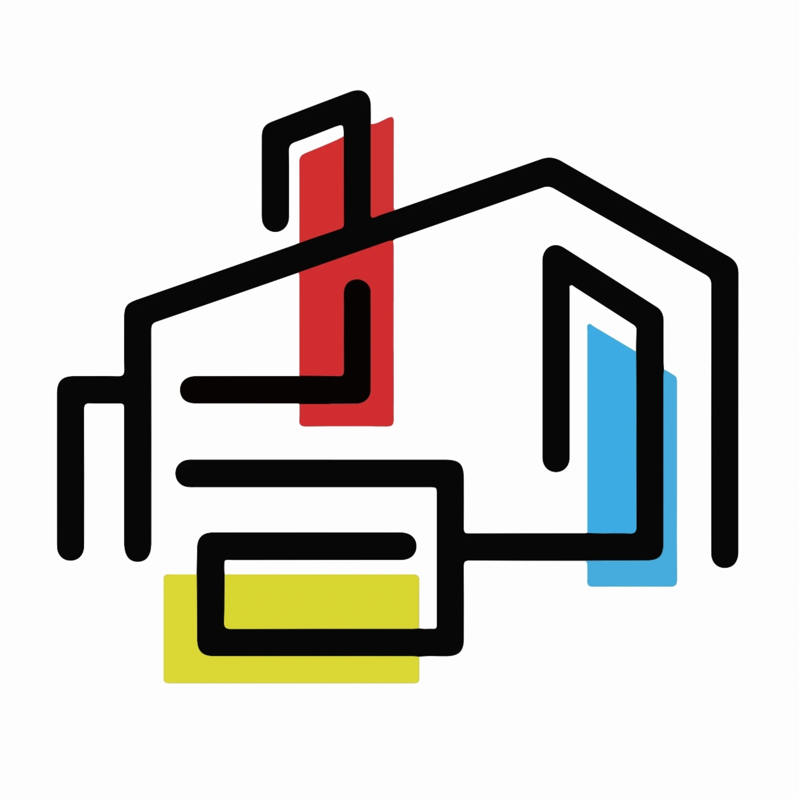
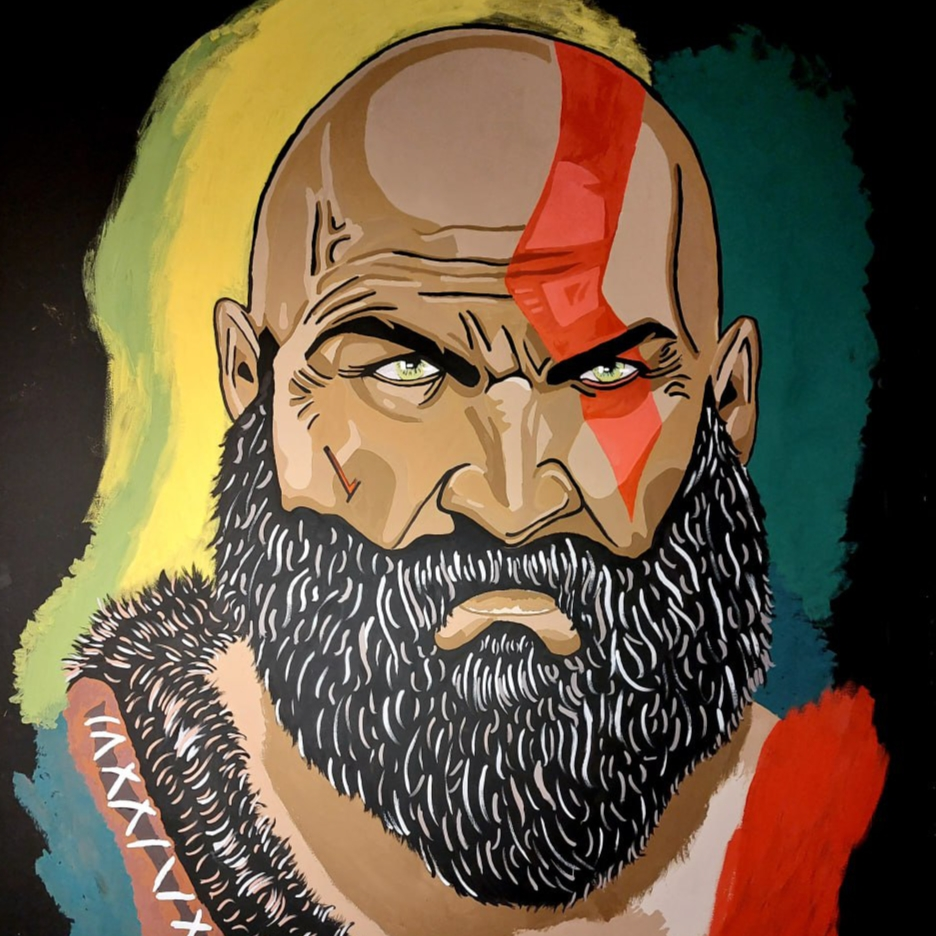
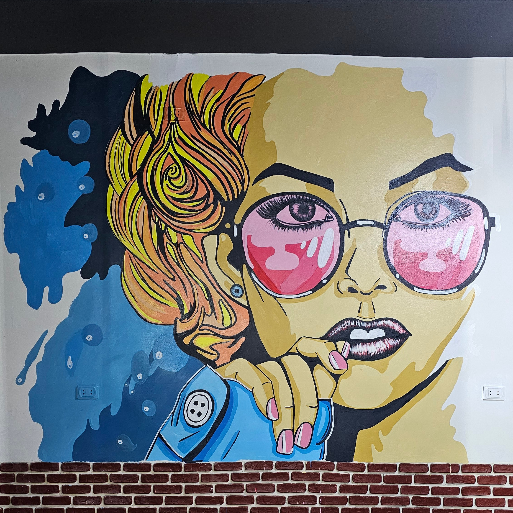
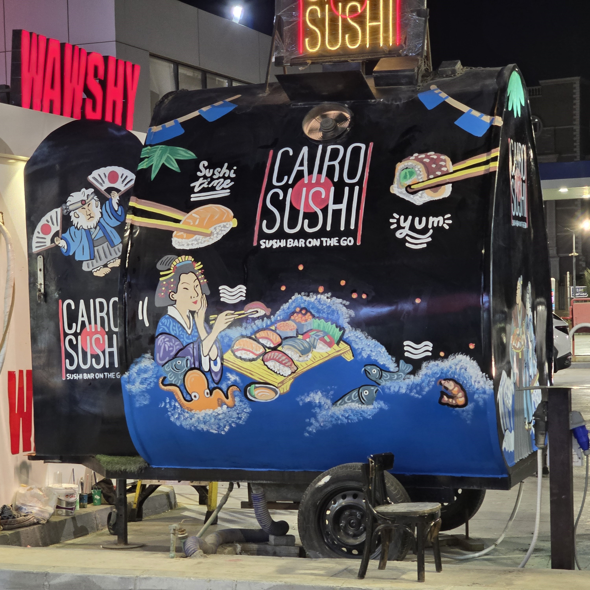
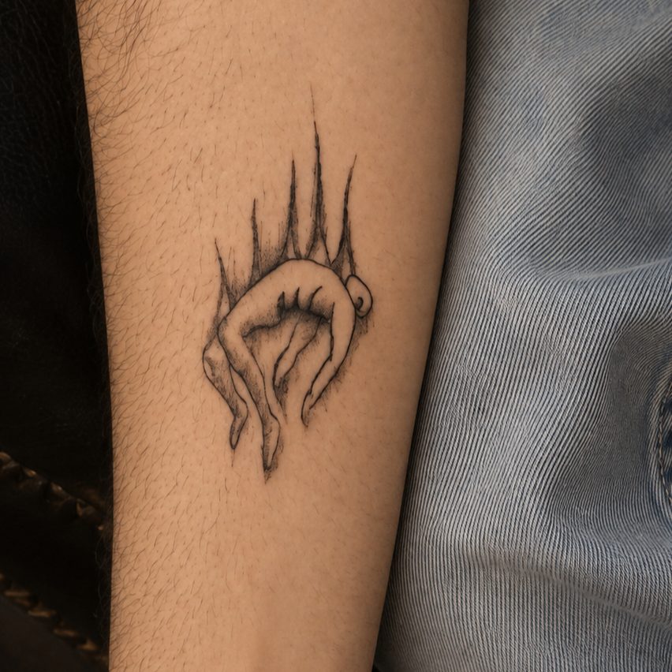
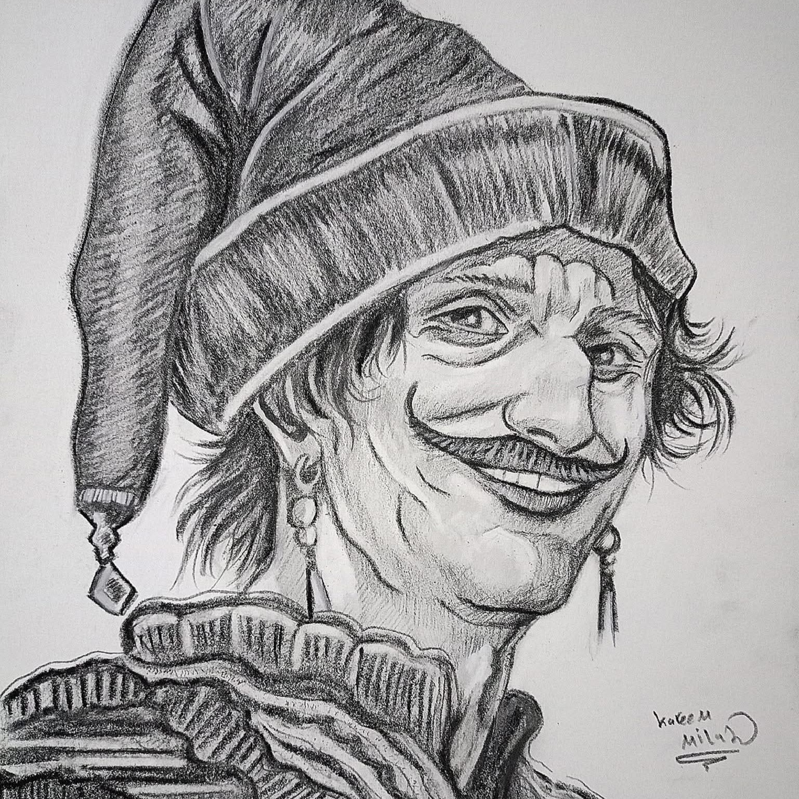
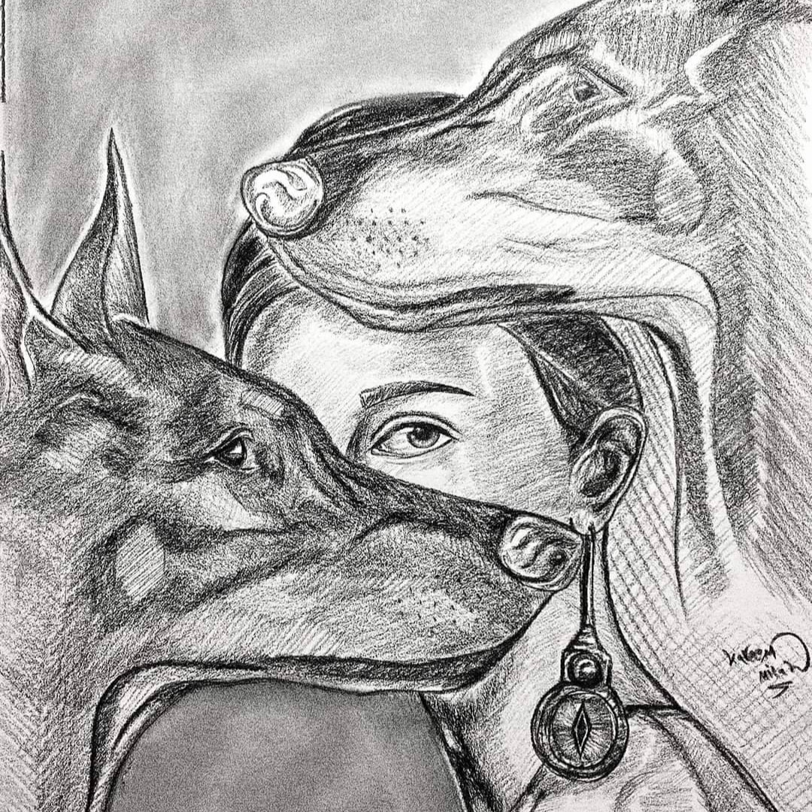

<meta name="viewport" content="width=device-width, initial-scale=1.0">
<title>Bet Elfan — Graphic Designer &amp; Visual Artist</title>
<meta name="description" content="Bet Elfan is a graphic designer and visual artist in Giza, Egypt. Graffiti, tattoo design, pencil portraits and mosaic with a story to tell.">
<meta name="theme-color" content="#F1F0EA">
<meta property="og:type" content="website">
<meta property="og:title" content="Bet Elfan — Graphic Designer &amp; Visual Artist">
<meta property="og:description" content="Where graphic design meets fine art — visuals with a story to tell.">
<meta property="og:image" content="logo.webp">
<!-- Favicon: put logo.webp in the same folder as index.html -->
<link rel="icon" type="image/webp" href="logo.webp">
<link rel="shortcut icon" href="logo.webp">
<link rel="apple-touch-icon" href="logo.webp">
<link rel="preconnect" href="https://fonts.googleapis.com">
<link rel="preconnect" href="https://fonts.gstatic.com" crossorigin>
<link href="https://fonts.googleapis.com/css2?family=Archivo+Black&family=Inter:wght@400;500;600;700&display=swap" rel="stylesheet">

</head>
<body>
<a href="#work" class="skip">Skip to content</a>

<header>
  <nav class="nav" aria-label="Main">
    <a href="#top" class="brand">Bet Elfan</a>
    <button class="navtoggle" id="navToggle" aria-label="Open menu" aria-expanded="false" aria-controls="navLinks">☰</button>
    <ul class="navlinks" id="navLinks">
      <li><a href="#work">Work</a></li>
      <li><a href="#about">About</a></li>
      <li><a href="#contact">Contact</a></li>
    </ul>
  </nav>
</header>

<main id="top">
<section class="hero wrap">
  
Graphic Designer &amp; Visual Artist, Giza, Egypt

  <h1>Where graphic design meets fine art — visuals with a story to tell.</h1>
  
For 10 years, I've turned empty spaces into something worth looking at — from street walls to tattoo designs to the fine detail of a pencil portrait. Each piece tells its own story.

  <a href="#work" class="btn">See the work</a>
</section>

<section class="section" id="work">
  

    

      

        <h2>Graffiti</h2>
        
Bold colors and free-flowing lines that turn walls into stories.

      

      

        <figure class="shot" data-label="Photo coming soon"><button type="button" aria-label="View larger"></button></figure>
        <figure class="shot" data-label="Photo coming soon"><button type="button" aria-label="View larger"></button></figure>
        <figure class="shot" data-label="Photo coming soon"><button type="button" aria-label="View larger"></button></figure>
      

    

    

      

        <h2>Tattoo Design</h2>
        
Custom tattoo designs, drawn from each client's own story and details.

      

      

        <figure class="shot" data-label="Photo coming soon"><button type="button" aria-label="View larger"></button></figure>
        <figure class="shot" data-label="Photo coming soon"><button type="button" aria-label="View larger"></button></figure>
        <figure class="shot" data-label="Photo coming soon"><button type="button" aria-label="View larger"></button></figure>
      

    

    

      

        <h2>Pencil Portraits</h2>
        
Pencil portraits focused on detail and expression.

      

      

        <figure class="shot" data-label="Photo coming soon"><button type="button" aria-label="View larger"></button></figure>
        <figure class="shot" data-label="Photo coming soon"><button type="button" aria-label="View larger"></button></figure>
        <figure class="shot" data-label="Photo coming soon"><button type="button" aria-label="View larger"></button></figure>
      

    

    

      

        <h2>Mosaic</h2>
        
Scattered pieces coming together into one complete picture.

      

      

        <!-- Add photos like: <figure class="shot" data-label="Photo coming soon"><button type="button" aria-label="View larger"></button></figure> -->
        <figure class="shot missing" data-label="Photos coming soon"></figure>
        <figure class="shot missing" data-label="Photos coming soon"></figure>
        <figure class="shot missing" data-label="Photos coming soon"></figure>
      

    

  

</section>

<section class="section" id="about">
  

    

      <h2>About</h2>
      
For 10 years, I've turned empty spaces into something worth looking at — from street walls to tattoo designs to the fine detail of a pencil portrait. Each piece tells its own story.

      

        Spray Paint &amp; Markers
        Procreate
        Adobe Photoshop
        Tattoo Machine &amp; Ink
        Graphite Pencils
        Mosaic Tiles &amp; Grout
      

    

    

      
Bet Elfan

      
Graphic Designer &amp; Visual Artist based in Giza, Egypt.

      <ul>
        <li>Graffiti</li>
        <li>Tattoo Design</li>
        <li>Pencil Portraits</li>
        <li>Mosaic</li>
      </ul>
    

  

</section>

<section class="section contact" id="contact">
  

    

      <h2>Got a project in mind?</h2>
      
Reach out and let's talk — whether it's a wall, a tattoo idea, or a portrait.

      <a href="mailto:karim.mifamikhail@gmail.com" class="btn">Email me</a>
    

    

      <a href="mailto:karim.mifamikhail@gmail.com" aria-label="Email" title="Email"><svg width="22" height="22" viewBox="0 0 24 24" fill="none" stroke="currentColor" stroke-width="2" aria-hidden="true"><rect x="2" y="4" width="20" height="16" rx="2"/><path d="m2 6 10 7 10-7"/></svg></a>
      <a href="https://wa.me/201226114191" target="_blank" rel="noopener" aria-label="WhatsApp" title="WhatsApp"><svg width="22" height="22" viewBox="0 0 24 24" fill="none" stroke="currentColor" stroke-width="2" aria-hidden="true"><path d="M21 11.5a8.38 8.38 0 0 1-.9 3.8 8.5 8.5 0 0 1-7.6 4.7 8.38 8.38 0 0 1-3.8-.9L3 21l1.9-5.7a8.38 8.38 0 0 1-.9-3.8 8.5 8.5 0 0 1 4.7-7.6 8.38 8.38 0 0 1 3.8-.9h.5a8.48 8.48 0 0 1 8 8v.5z"/></svg></a>
      <a href="https://www.facebook.com/share/188HzFeGK4/" target="_blank" rel="noopener" aria-label="Facebook" title="Facebook"><svg width="22" height="22" viewBox="0 0 24 24" fill="none" stroke="currentColor" stroke-width="2" aria-hidden="true"><path d="M18 2h-3a5 5 0 0 0-5 5v3H7v4h3v8h4v-8h3l1-4h-4V7a1 1 0 0 1 1-1h3z"/></svg></a>
      <a href="https://www.instagram.com/bet_elfan_" target="_blank" rel="noopener" aria-label="Instagram" title="Instagram"><svg width="22" height="22" viewBox="0 0 24 24" fill="none" stroke="currentColor" stroke-width="2" aria-hidden="true"><rect x="2" y="2" width="20" height="20" rx="5"/><circle cx="12" cy="12" r="4"/><circle cx="17.5" cy="6.5" r="1"/></svg></a>
      <a href="https://www.tiktok.com/@bet_elfan" target="_blank" rel="noopener" aria-label="TikTok" title="TikTok"><svg width="22" height="22" viewBox="0 0 24 24" fill="none" stroke="currentColor" stroke-width="2" aria-hidden="true"><path d="M9 12a4 4 0 1 0 4 4V4a5 5 0 0 0 5 5"/></svg></a>
      <a href="https://github.com/karimmifamikhail-arch" target="_blank" rel="noopener" aria-label="GitHub" title="GitHub"><svg width="22" height="22" viewBox="0 0 24 24" fill="none" stroke="currentColor" stroke-width="2" aria-hidden="true"><path d="M9 19c-5 1.5-5-2.5-7-3m14 6v-3.9a3.4 3.4 0 0 0-.9-2.6c3-.3 6.1-1.5 6.1-6.6a5.1 5.1 0 0 0-1.4-3.5 4.8 4.8 0 0 0-.1-3.5s-1.1-.3-3.6 1.4a12.3 12.3 0 0 0-6.4 0C6.2 2.8 5.1 3.1 5.1 3.1a4.8 4.8 0 0 0-.1 3.5A5.1 5.1 0 0 0 3.6 10.1c0 5.1 3.1 6.3 6.1 6.6a3.4 3.4 0 0 0-.9 2.6V22"/></svg></a>
    

  

</section>
</main>

  <button class="lb-close" id="lbClose" aria-label="Close">✕</button>
  

<footer>© 2026 Bet Elfan. All rights reserved.</footer>

</body>
